<p align="center">
  <a href="https://tend.ashwin.co.in">
    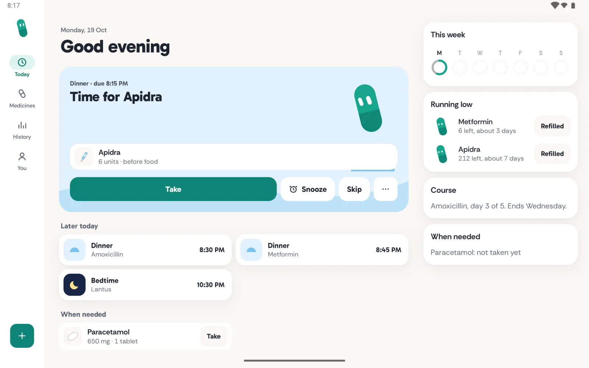
  </a>
</p>

<p align="center">
  <a href="https://tend.ashwin.co.in"><strong>tend.ashwin.co.in</strong></a>
  &nbsp;·&nbsp;
  <a href="https://github.com/Ashwin-S-Nambiar/Tend/releases/latest/download/tend.apk">download the apk</a>
  &nbsp;·&nbsp;
  <a href="#what-it-does">what it does</a>
  &nbsp;·&nbsp;
  <a href="#running-it">running it</a>
</p>

<br>

tend is a gentle medicine reminder for android. add what you take and when, and pip, a small teal capsule, taps you on the shoulder at each scheduled time. reminders are exact alarms on the phone, Taken and Snooze work right from the notification, and medicines and logs never leave the device. there is no account and no server.

this repo holds the android app in [`android/`](./android/README.md) and its marketing page at the root, which is what [tend.ashwin.co.in](https://tend.ashwin.co.in) serves. tend started as a web app on that domain; it moved to android because a web page can't schedule reliable local reminders.

the screenshots use sample medicines, doses and logs. they demonstrate the app, not a treatment plan.

## what it does

<p align="center">
  
  &nbsp;
  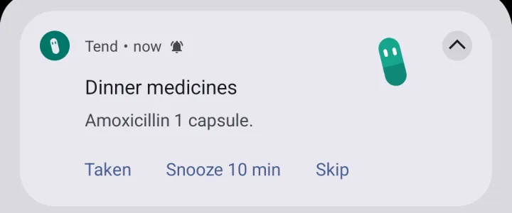
  &nbsp;
  
</p>

- **times around your day.** link a medicine to waking, breakfast, lunch, dinner or bedtime, or give it a clock time. changing breakfast moves its linked reminders; fixed clock reminders stay put. weekends can have their own times.
- **different doses at different times.** meal-time insulin can have separate prescribed amounts at breakfast, lunch and dinner. tend does not calculate or recommend doses.
- **alarms on the minute.** each reminder is a local exact alarm, falling back to inexact when that isn't allowed. a follow-up comes 30 minutes later if nothing is logged. alarms re-arm after a reboot, a clock or time-zone change and an app update.
- **log from the notification.** Taken, Snooze 10 min and Skip work without opening the app. with names hidden, the lock screen says "Time for your 8:00 AM medicines" and nothing else.
- **logging that forgives.** take a group at once or one medicine, snooze, skip, swipe a row to skip just that one, or long-press Take and spin the wheel to the time you actually took it. everything has Undo.
- **a form that fits the medicine.** tablets, capsules, liquids, insulin, other injections, inhalers, drops, creams and patches get relevant fields and units.
- **flexible schedules.** every day, chosen weekdays, every few days, on and off cycles, once, or when needed with optional minimum gaps and daily limits. courses end on their own and show their current day.
- **prescription shorthand and label scanning.** `Metformin 500mg 1-0-1 PC` or `Inj Apidra 14-8-6 units AC` fills the form for you to review. the camera button reads a label with on-device text recognition; the photo never leaves the phone.
- **refill reminders.** count tablets, ml, puffs, patches or units. each logged dose takes its amount; a refill adds the saved pack size.
- **history without streaks.** a ring for each of the last seven days, the times for any day, and a percentage per medicine over 30 days.
- **widgets and shortcuts.** a next-dose widget with Take and Snooze, a small next-dose widget, a week-rings widget, long-press shortcuts and a themed monochrome icon.
- **travel.** follow the local clock or keep reminders on home time. tend notices a new zone and asks.
- **share and keep.** a medicines card to share, an `.ics` calendar export with alerts, and a json backup and restore. android auto backup also copies the data.
- **onboarding that asks once.** notifications, exact alarms, and a link to the autostart and battery screens xiaomi, oppo, oneplus, realme and vivo use to stop background alarms.
- **tablets and foldables.** a navigation rail, medicines and history as list and detail side by side, and a context pane beside today.

<p align="center">
  
  &nbsp;
  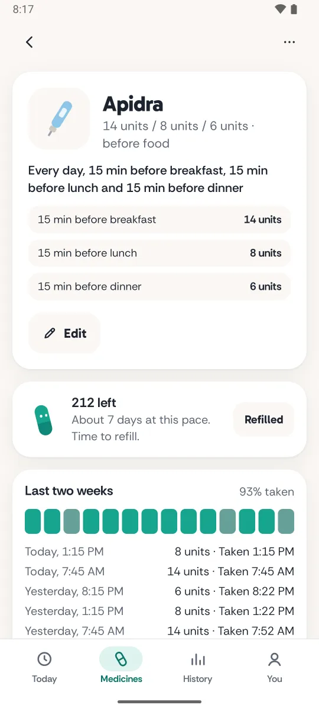
  &nbsp;
  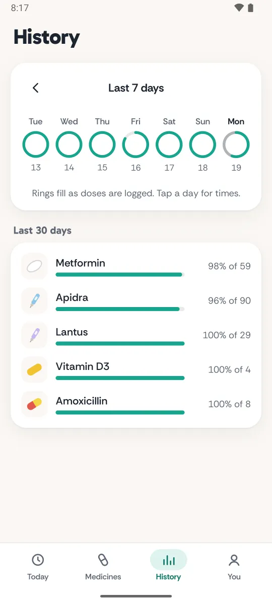
  &nbsp;
  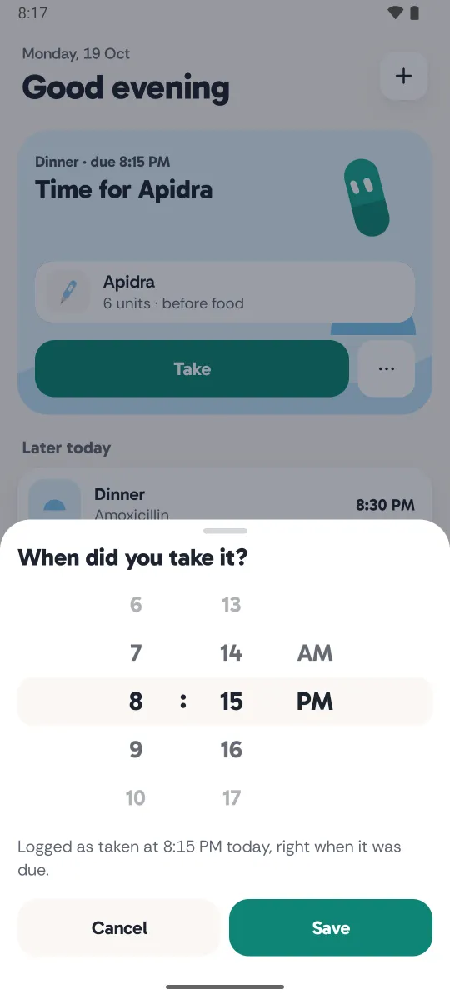
</p>

### adding a medicine

the editor has three steps: what you take, when you take it, and a review that shows each dose with its actual reminder time. shared meal and sleep times change only when you save, with a note about other medicines they move.

<p align="center">
  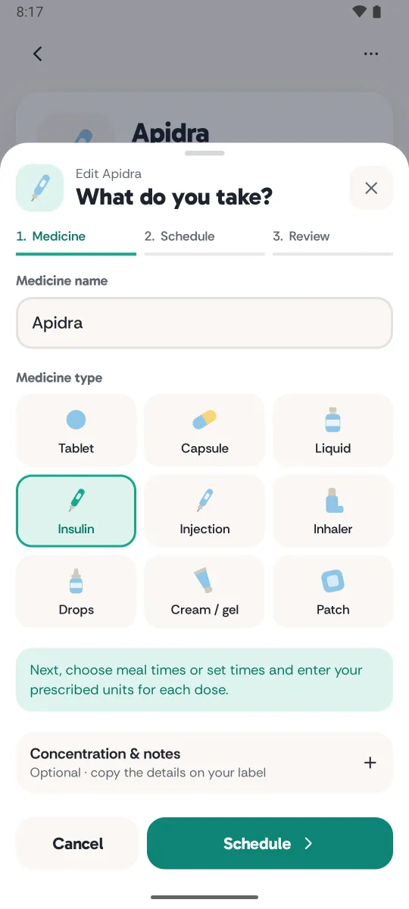
  &nbsp;
  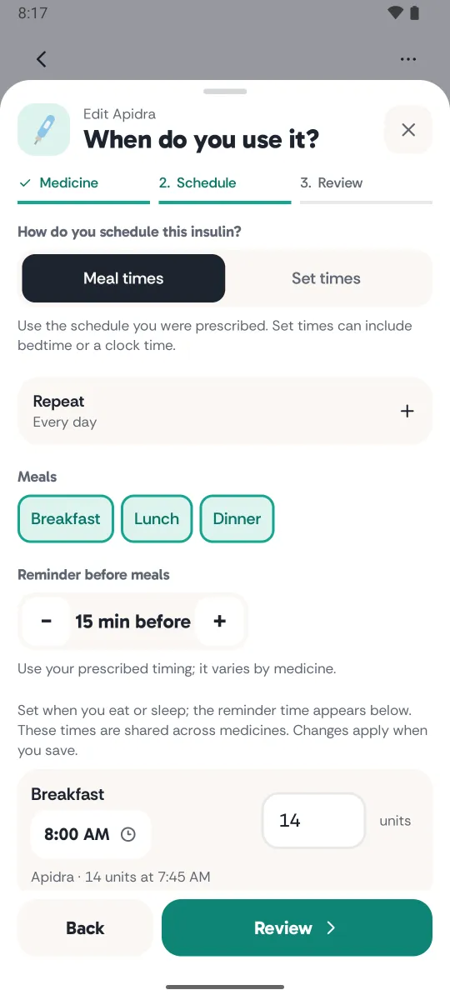
  &nbsp;
  
  &nbsp;
  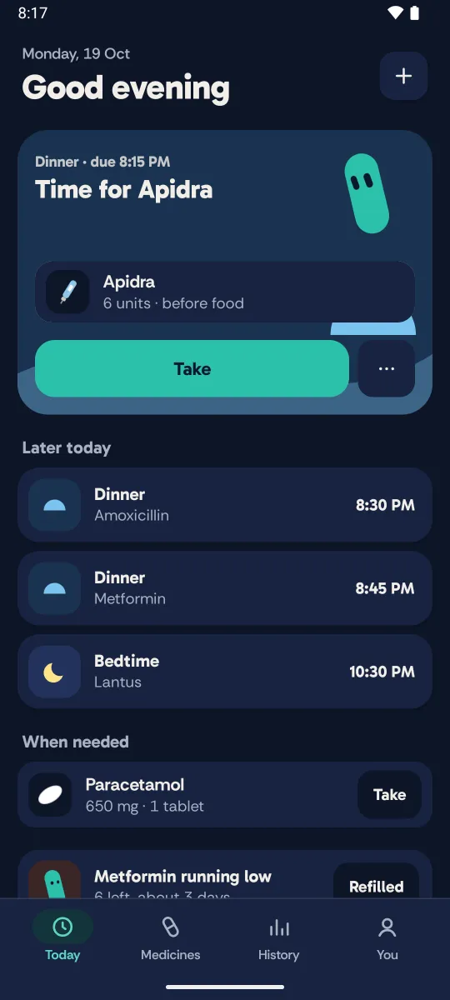
</p>

## how reminders work

`core/Reminders.kt` turns the schedule into a list of reminders and follow-ups. only one alarm is armed at a time, for the earliest of the next reminder, follow-up or the 9 am refill check. when it rings, `Alarms.ring` posts everything due since the last ring, then arms the next one. any change to the data re-arms it and clears notifications for doses that are now logged, so a dose taken in the app never rings later.

the notification buttons go to `ActionReceiver`, which applies the same pure actions the screens use (`core/Actions.kt`) and waits for the write to reach disk before returning. more in [`android/README.md`](./android/README.md).

## the design

the object is pip's day: sunrise, noon, dusk and night scenes, each with its own wash, orb and hill. teal is the one action colour.

- **pip.** a capsule with spring-driven eyes and gaze, a blink, a poke and a few poses. on android the eyes run on hand-written springs and the body on keyframes; on the page the same rig drives inline svgs that ship with each mood's resting eyes drawn in, so pip looks right before the script runs and under reduced motion.
- **type.** gabarito for headings, times and buttons; rethink sans for reading. self-hosted on the page with tuned fallback metrics, bundled in the app.
- **sheets.** one component. on phones it rises on the drawer curve, follows the finger down 1:1, rubber-bands up, closes past 30% or on a flick, and the back gesture previews the close. from 600dp wide it's a centred dialog.
- **sound and touch.** every sound is synthesized pcm, rendered once into a static track and replayed from the start, so sounds never queue. each has a minimum gap, repeats inside it are dropped, and haptic ticks are throttled. the time wheel ticks under your thumb for each value and clicks once where it lands. animator scale 0 silences both.
- **night.** the app follows the system theme until you choose. logging the last bedtime dose turns today navy with a sleeping pip. the page follows the system theme and shows the dark app in its hero when it's dark.
- **the page.** a static html page told as a day, from a 7:45 am breakfast dose to a 10:30 pm bedtime one. the screenshots sit in css device frames modelled on the oneplus 13 and pad 3: a metal rim, slim bezels, a punch-hole camera, the real button layout and a status bar drawn in html that follows each screen's theme. on phones the download button moves into a bottom dock once the hero's button scrolls away. images reserve their boxes, so nothing shifts as they load.

## the stack

| layer | choices |
| --- | --- |
| app | kotlin 2.4, jetpack compose (bom 2026.09), agp 9.4 with built-in kotlin |
| app libraries | kotlinx.serialization, core-splashscreen, ml kit text recognition (bundled); no navigation or material libraries |
| page | static html, css and two small typescript modules, built with vite 8 |
| tooling | biome, playwright for the share image, github actions for signed releases |
| hosting | vercel for the page, github releases for the apk |

## running it

### the app

needs jdk 17 and the android sdk with platform 37.

```sh
cd android
./gradlew :app:testDebugUnitTest   # the ported logic tests
./gradlew :app:installDebug        # installs "in.co.ashwin.tend.debug" beside a release build
```

push a tag like `v1.0.0` to release. `.github/workflows/android-release.yml` runs the tests, builds a signed apk and attaches it to the github release as `tend-1.0.0.apk` and `tend.apk`; the page links to `releases/latest/download/tend.apk`. signing and the repository secrets are in [`android/README.md`](./android/README.md#releasing).

### the page

node 24.

```sh
npm install
npm run dev          # http://localhost:5173
npm run check        # lint, format and import order
npm run typecheck
npm run build
```

`node scripts/og.mjs` renders the social share image from `scripts/og.html`.

## the shape of it

```text
android/        the app (see android/README.md)
index.html      the page
src/
  main.ts       the download dock
  pip.ts        pip's eye rig
  site.css      scenes, frames, sections and pip's keyframes
public/         fonts, icons, app screenshots, the share image and the 404 page
docs/
  screenshots/  images used in this README
scripts/        share image rendering
```

## known rough edges

- **not on the play store.** installing means allowing your browser to install apps once. updates are a newer download installed over the top; the app doesn't check for them yet.
- **oem battery savers.** the autostart screens move between os versions; when none is found tend opens battery optimisation settings, then the app's own settings page.
- **widgets** refresh on every change and alarm, and at least every 30 minutes; a widget can show the previous state for a moment after a reboot.
- **label scanning** reads latin script only, and works best on a printed prescription or box rather than a curved bottle.
- **android only.** there's no ios app.
- **accessibility needs more device testing.** talkback and the largest font sizes still need a physical-device pass.

<details>
<summary><strong>the page</strong></summary>

<br>

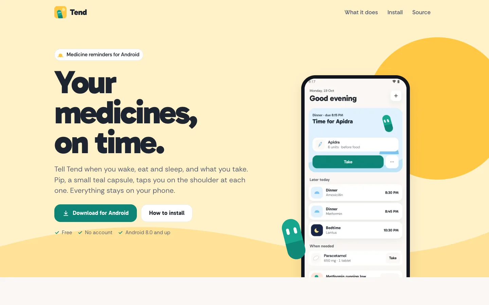

<p align="center">
  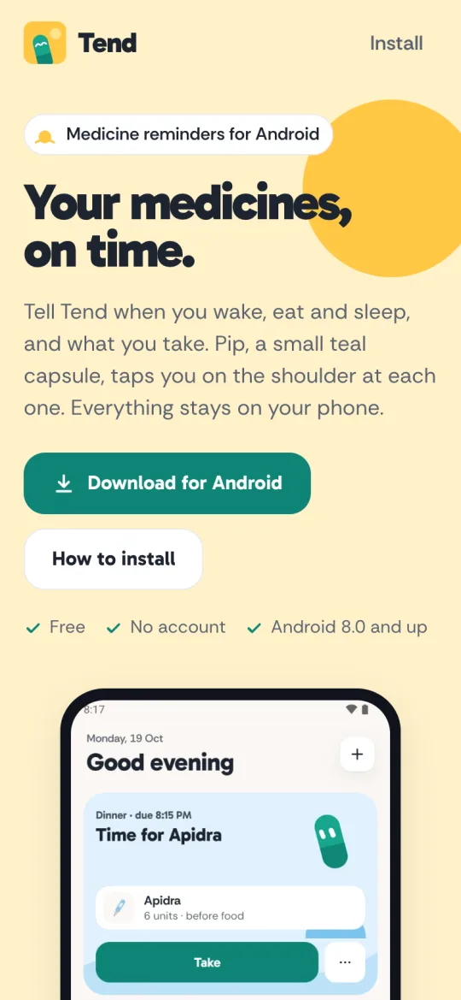
  &nbsp;
  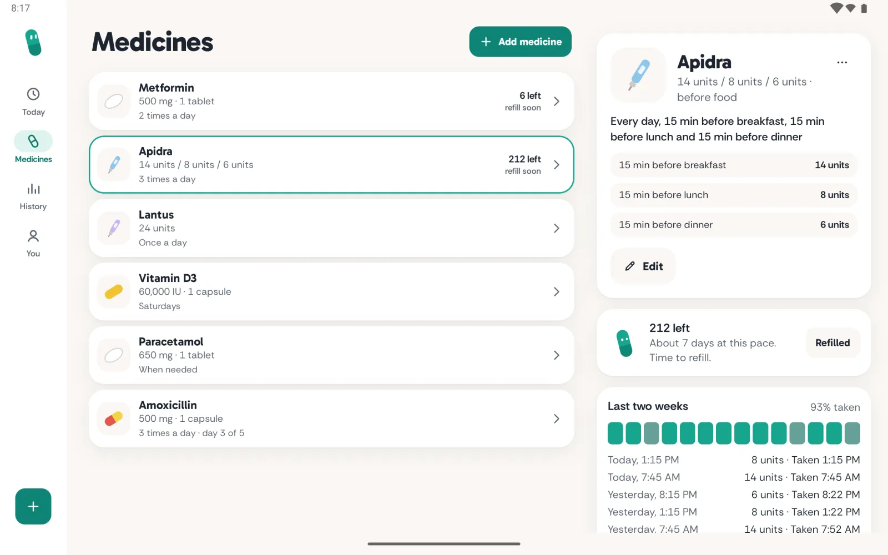
</p>

</details>

## references

the medicine field choices draw on NHS guidance for [insulin](https://www.nhs.uk/medicines/insulin/rapid-acting-insulin/how-and-when-to-take-rapid-acting-insulin/), [topical treatments](https://www.nhs.uk/medicines/mometasone-for-skin/how-and-when-to-use-mometasone-for-skin/), [patches](https://www.nhs.uk/medicines/buprenorphine-for-pain/how-and-when-to-use-buprenorphine/), [inhalers](https://www.nhs.uk/medicines/salbutamol-inhaler/how-and-when-to-use-salbutamol-inhalers/) and [drops](https://www.nhs.uk/medicines/dexamethasone-eye-drops/how-and-when-to-use-dexamethasone-eye-drops/). tend records a prescribed plan; it does not provide treatment advice.
