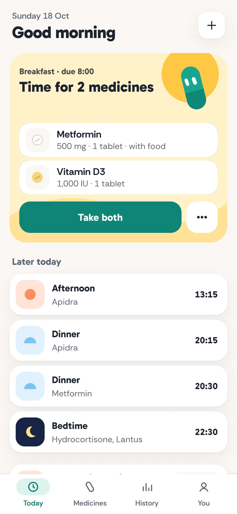
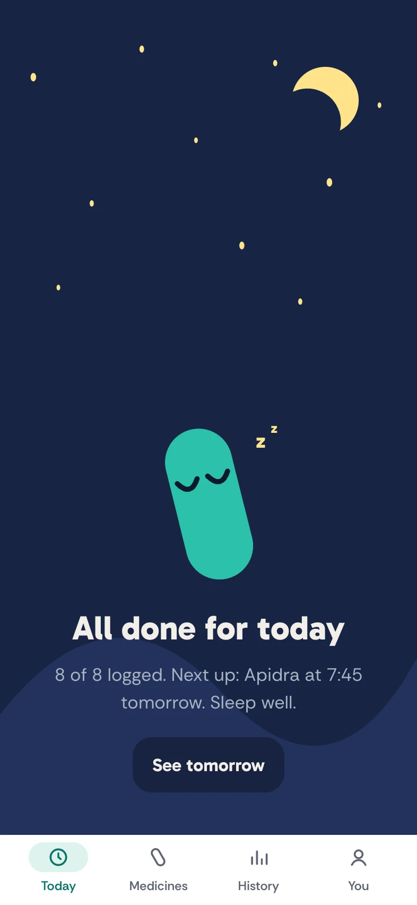
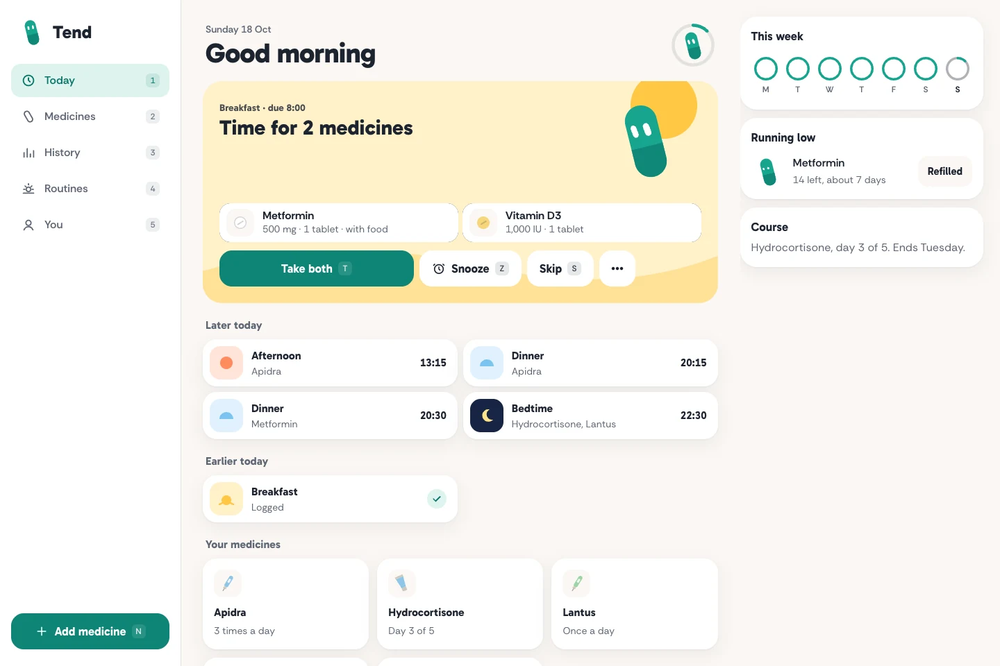

# tend

a gentle medicine reminder that lives on your phone. tell it when your day happens and what you take, and pip, a small teal capsule, taps you on the shoulder at each routine.

<p>
  
  
  
  
</p>



## what it does

- **routines, not alarms.** you set when you wake, eat and sleep once. a dose hangs off a routine ("30 min before breakfast", "at bedtime") or a clock time, so moving breakfast moves every morning dose. weekends can have their own times.
- **every schedule people actually get.** every day, chosen weekdays, every few days, on and off cycles, once, and when needed with a minimum gap and a daily maximum. courses end on their own and show "day 3 of 5".
- **type it like the prescription.** `Metformin 500mg 1-0-1 PC`, `Syp Calpol 5ml TDS x 3 days`, `Tab Dolo 650mg SOS`. the add sheet reads the shorthand and echoes it back in plain words before saving.
- **logging that forgives.** take a whole routine at once, one medicine, or at another time (long-press). snooze, skip, swipe a row to skip just that one. every action has undo. a dose you never logged says not logged, never missed.
- **stock.** a count per medicine that drops when you take it, a refill nudge at seven days of supply, and a refilled button that adds a strip.
- **history without streaks.** a ring per day for the week, the times for any day, and a gentle percentage per medicine over 30 days.
- **for the doctor.** a my medicines card to share or copy, an `.ics` export with alerts for anyone who won't install, and a json backup and restore.
- **everything stays on the phone.** medicines and logs live in indexeddb. the reminder server only ever sees an anonymous device id and some times.

### left out on purpose

- interaction checks. that is medical advice, there is no free licensed data, and most indian brands are missing.
- name lookup. rxnorm is us only, so names you have already typed are suggested instead.
- caregiver alerts. they need accounts. maybe later.
- alarms that break silent mode. the web can't.
- streaks.

## how reminders work without an app

a web page can't schedule a local notification (chrome's notification triggers have sat behind a flag since 2022), so a tiny server sends a web push at each routine.

1. the phone works out the next 14 days of routine times itself and sends `PUT /plan/<device>` with the push subscription and a list of `{ key: "2026-10-17T08:00", at }`. no names, no doses.
2. a cloudflare worker routes each device to its own sqlite-backed durable object, which stores the list and calls `setAlarm()` for the earliest one.
3. the alarm sends the push (rfc 8291 `aes128gcm` encryption and an es256 vapid token, all web crypto, about 100 lines in `worker/src/push.ts`, checked byte for byte against the rfc's example), queues one follow-up 30 minutes later, and re-arms for the next item.
4. the service worker wakes, reads the plan it saved in indexeddb, and writes the notification on the phone: "Morning medicines", "Metformin 500 mg and Vitamin D3, after food." with taken and in 10 min buttons. hide names in settings and it says "Time for your 8:00 medicines".
5. taken logs straight into indexeddb and tells the server to drop the follow-up. snooze re-arms in ten minutes. a tap opens `/dose/<key>`.

the free plan covers it: alarms count as requests and each `setAlarm()` is one row write, about 15 of each per person a day against 100,000. no cron triggers are used.

iphones get pushes only once tend is on the home screen, and without action buttons, so a tap lands on the dose sheet. onboarding shows the add to home screen steps there.

## pip

pip is one svg with two quadratic-curve eyes. each eye blends between a pill (a short stroke with round caps) and an arc, so happy is a smile of arches and asleep is a pair of cups. gaze, size and the curve run on closed-form springs at 120 hz, written straight to the nodes, never through react. pip blinks, glances about, follows the pointer, squashes when poked, and stops its loop when off screen or the tab is hidden. under reduced motion the poses just fade.

## the design

- **headspace's warmth with our own parts.** one round character, soft scenes instead of photos, big rounded controls, very few words. the house rule of one physical object is waived for this one.
- **teal means log it.** `#0e8576` is the only colour on controls and it means due now. the four routine scenes (sunrise, noon, dusk, night) are backgrounds only. taken isn't green and not logged isn't red.
- **a night mode that earns it.** the bedtime dose gets checked in a dark room, so dark follows the system, and once bedtime is logged today turns navy and pip goes to sleep whatever the theme.
- **type.** gabarito for greetings, titles, times and buttons, rethink sans for names, doses and everything you read. both ofl, self-hosted as latin and latin-ext woff2, preloaded, with arial fallbacks tuned by size-adjust and ascent, descent and line-gap overrides so nothing jumps when they load.
- **one layout per size.** a bottom tab bar on phones, a rail in landscape and on tablets, a context panel from 1024 where the dose and medicine details open, and a sidebar with keys from 1440.
- **installed, it feels installed.** standalone with no url bar, an animated pip splash with matching ios launch images, and theme colours for the status bar.

## keyboard

| key | does |
|---|---|
| `t` | take what is due |
| `z` | snooze 10 minutes |
| `s` | skip what is due |
| `enter` | open the due dose |
| `n` | add a medicine |
| `1` to `5` | today, medicines, history, routines, you |
| `⌘ z` | undo |
| `esc` | close a sheet or panel |

## the stack

react 19, vite 8, tailwind 4, typescript 7, biome 2 with a pre-commit hook, node 24. no ui or animation libraries: sheets, swipes, springs and view transitions are hand written. the reminder server is a cloudflare worker with a durable object. sounds are synthesised in web audio and haptics are named `navigator.vibrate` patterns.

## running it

```sh
npm install
npm run dev          # http://localhost:5173
npm test             # schedule, shorthand and dose format
npm run build

cd worker
npm install
npm run keys         # prints a vapid key pair
npm test             # rfc 8291 and vapid checks
npm run dev          # http://localhost:8787
```

for reminders locally, put the private key in `worker/.dev.vars` as `VAPID_PRIVATE='{...}'` with `VAPID_PUBLIC=...`, and in `.env.local` set `VITE_PUSH_URL=http://localhost:8787` and `VITE_VAPID_PUBLIC=...`. the service worker only registers in a production build, so use `npm run build && npx vite preview`.

to ship the worker: `wrangler secret put VAPID_PRIVATE`, set `VAPID_PUBLIC` in `wrangler.toml`, `npm run deploy`, and point `VITE_PUSH_URL` at it.

`node scripts/og.mjs` renders `public/og.jpg` from `scripts/og.html`.

## the shape of it

```
src/
  app/          layout modes, nav (tab bar, rail, sidebar), theme, shortcuts
  screens/      Welcome, Today, DoseSheet, Medicines, MedicineDetail, MedicineEdit,
                History, Routines, You, NotFound, PipLab (dev only, /pip)
  components/   Pip, Scene, Sheet, SwipeRow, MedRow, DayRing, WeekRings, ...
  lib/          schedule, shorthand, dose-format (with tests), db, push,
                actions, today, route, sound, haptics, ics, backup
public/         sw.js, manifest, icons, splash, fonts with their licences
worker/         the reminder server
```

## known rough edges

- the icon set and every line of copy are still waiting on a final pick.
- travel mode (keep home time abroad) isn't built yet.
- an installed android app shows chrome's own splash for a moment before pip's.
- if nobody opens the app for 14 days the plan runs dry. the last reminder says so.
- not yet checked on real phones, with voiceover or talkback, or at the largest text sizes.
