<p align="center">
  <a href="https://tend.ashwin.co.in">
    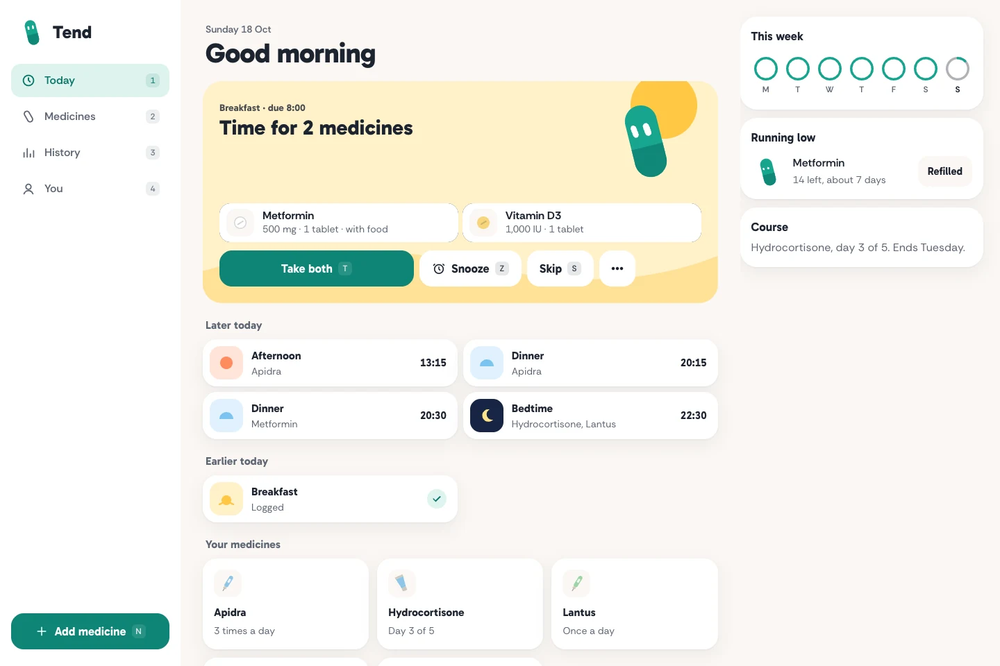
  </a>
</p>

<p align="center">
  <a href="https://tend.ashwin.co.in"><strong>tend.ashwin.co.in</strong></a>
  &nbsp;·&nbsp;
  <a href="#what-it-does">what it does</a>
  &nbsp;·&nbsp;
  <a href="#the-design">the design</a>
  &nbsp;·&nbsp;
  <a href="#running-it">running it</a>
</p>

<br>

the source of **[tend.ashwin.co.in](https://tend.ashwin.co.in)**, a gentle medicine reminder that lives on your phone. add what you take and when, and pip, a small teal capsule, taps you on the shoulder at each scheduled time.

reminders can follow meals, waking or bedtime, or stay at a fixed clock time. a medicine can have a different dose at each reminder. medicines and logs stay on your device; a small server receives the reminder timestamps and sends the web pushes.

the screenshots use sample medicines, doses and logs. they demonstrate the app, not a treatment plan.

there is also a native android app in [`android/`](./android/README.md), with local exact alarms, Taken and Snooze on the notification, widgets and label scanning. it reads the same backups.

## what it does

<p align="center">
  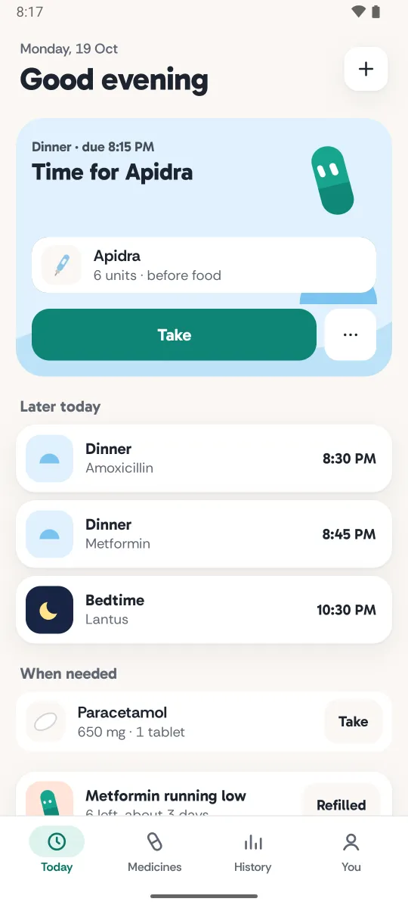
  &nbsp;
  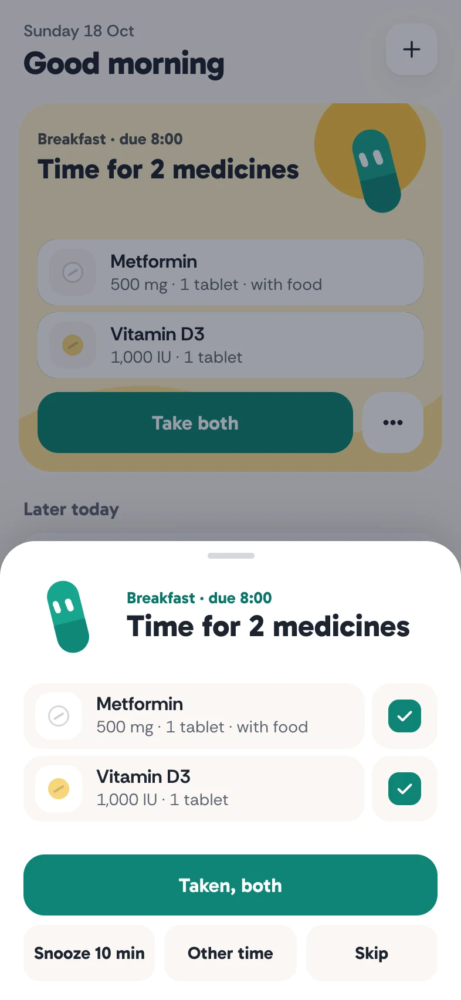
  &nbsp;
  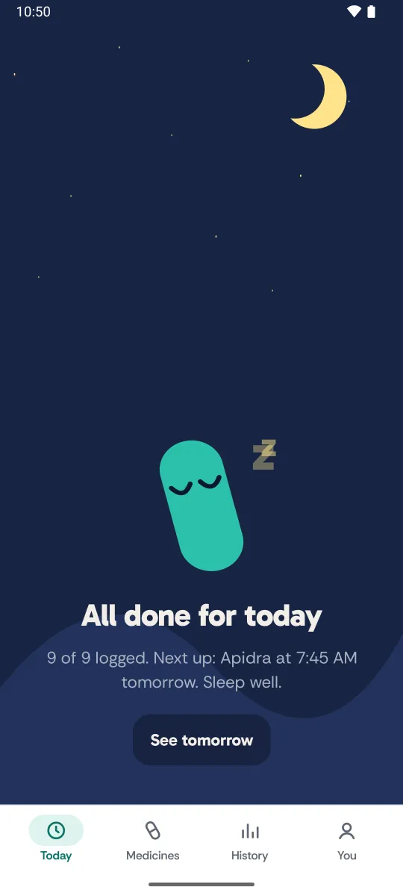
</p>

- **times around your day.** set relevant meal and sleep times while adding a medicine. changing breakfast moves its linked reminders; fixed clock reminders stay put. weekends can have their own times. shared times live under You → Meal & sleep times.
- **different doses at different times.** meal-time insulin can have separate prescribed unit amounts at breakfast, lunch and dinner. bedtime insulin can be a separate medicine. meal offsets are editable, and each dose shows its resulting reminder time. Tend does not calculate or recommend doses.
- **a form that fits the medicine.** tablets, capsules, liquids, insulin, other injections, inhalers, drops, creams and patches get relevant fields and units. no tablet count for a cream, or food timing for a patch.
- **flexible schedules.** every day, chosen weekdays, every few days, on and off cycles, once, or when needed. prescribed minimum gaps and daily limits are optional. courses end on their own and show their current day.
- **logging that forgives.** take a group at once, one medicine, or choose Log time to enter another time. snooze, skip, or swipe a row to skip just that one. actions have Undo. a dose you never logged says not logged.
- **refill reminders.** optionally count your remaining tablets, ml, puffs, patches or insulin units. logging a dose reduces the supply by that dose's amount. a refill adds the saved refill quantity.
- **edit, archive or delete.** open a medicine to change it. its menu can archive it while keeping history, or delete it and its logs with a brief Undo. closing a new-medicine sheet stays in Medicines, including when opened from Today.
- **history without streaks.** a ring for each day of the week, the times for any day, and a percentage per medicine over 30 days.
- **travel.** follow the local clock or keep reminders on your home time zone. Tend notices a new zone and asks.
- **share and keep.** a medicines card to share or copy, an `.ics` calendar export with alerts, and a JSON backup and restore. no account or caregiver server.
- **installable.** add Tend to your home screen, use its cached shell offline, and receive web push reminders where the browser supports them.

### adding a medicine

onboarding goes from welcome to medicines to reminder permission. add as many medicines as you need, using the same editor as the main app.

1. **medicine.** enter the name and type, then the relevant dose or application details. strength, concentration, notes and prescription shorthand are optional.
2. **schedule.** choose meals, waking, bedtime or clock times. edit the shared times this medicine uses, with its dose and reminder time shown together. weekday and weekend differences are explicit.
3. **review.** check the doses and actual reminder times. shared-time changes apply only when saved, with a note about other affected medicines. Cancel discards them and Undo restores them. refill tracking and pill appearance stay optional.

<p align="center">
  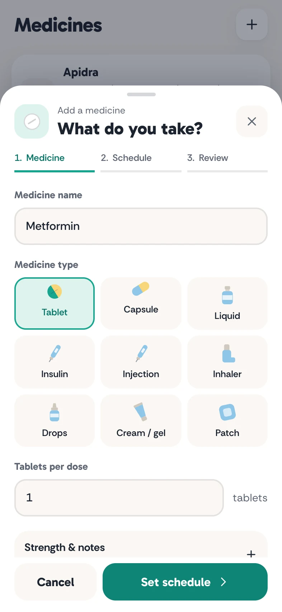
  &nbsp;
  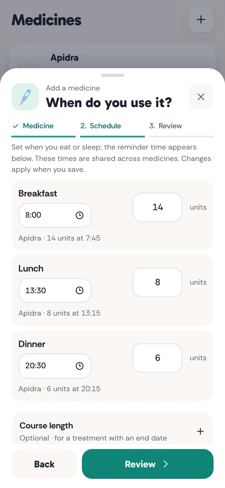
  &nbsp;
  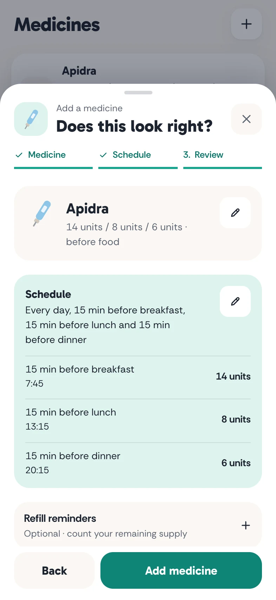
</p>

prescription shorthand is an optional shortcut. patterns such as `Metformin 500mg 1-0-1 PC`, `Syp Calpol 5ml TDS x 3 days`, or `Inj Apidra 14-8-6 units AC` produce a preview. choose **Use these details**, then review the filled form before saving.

### keys

| key | does |
| --- | --- |
| `T` | take what is due |
| `Z` | snooze 10 minutes |
| `S` | skip what is due |
| `Enter` | open the due dose |
| `N` | add a medicine |
| `1` to `4` | Today, Medicines, History, You |
| `⌘ Z` / `Ctrl Z` | Undo |
| `Esc` | close a sheet or panel |

## how reminders work

a web page cannot reliably schedule future local notifications. Tend calculates the times on the device and uses a small Cloudflare Worker to send a push at each one.

1. the phone calculates the next 14 days of reminders and sends a push subscription, reminder keys and timestamps. no medicine names or dose amounts go to the server.
2. one Durable Object per device keeps that plan and sets an alarm for the next reminder.
3. the alarm sends an encrypted web push, schedules a follow-up 30 minutes later if nothing is logged, then arms the next alarm.
4. the browser's service worker reads the local notification plan and supplies the medicine names, per-reminder doses and Taken and Snooze actions. hide names in You and notifications use a generic message.
5. Taken logs the dose in IndexedDB and cancels the follow-up. Snooze asks for another push in ten minutes. tapping the notification opens its dose sheet.

saved meal-time changes, weekend toggles and restored backups rebuild the local plan and sync fresh timestamps when reminders are enabled. doses and meal offsets are resolved on the device, so the current interface changes require no Cloudflare Worker API change or separate deployment.

opening Tend or reconnecting refreshes the server plan for an existing subscription. setup saves the local notification details before sending timestamps, and reminders show as on only after the server accepts them. a failed sync shows a connection error in You and retries when you reconnect or reopen the app.

on iPhones, web push requires adding Tend to the home screen. notification action buttons vary by browser; tapping a notification always opens its dose sheet. onboarding distinguishes permission from completed reminder setup: success shows a check mark and **Let's go**; a failed connection offers retry or continuing into the app.

reminder sound follows your browser and device notification settings. **You → In-app sounds** controls Tend's own chimes when you log a dose; it does not change notification sound.

### installed app updates

the home-screen app loads the deployed website. fresh navigations try the network first, with the cached page as an offline or slow-network fallback. scripts and styles have unique filenames, and service worker updates activate without reinstalling.

after deployment, close Tend from recent apps and reopen it online. an already-open screen can keep its existing code running. normal updates preserve medicines, logs and settings.

## the design

- **warm and quiet.** cream surfaces, round controls, simple scenes and one small character. teal is the action colour; sunrise, noon, dusk and night belong to the scenes.
- **pip.** an SVG capsule with spring-driven eyes and gaze, a blink, a poke and a few distinct poses. its loop stops when hidden or off screen, and reduced motion uses static poses and fades.
- **type.** gabarito for headings, times and buttons; rethink sans for the things you read. both are self-hosted and preloaded, with tuned fallback metrics to keep the layout steady while fonts load.
- **opens straight in.** installed, Tend launches on a still Pip in cream or navy to match the theme, then shows the app in a single frame once medicines and fonts are loaded. there's no second splash, fade or hold, so nothing moves between launch and the finished screen.
- **motion follows the task.** tabs crossfade without moving navigation. subpages open and return in opposite directions. desktop details animate within their own pane. selection indicators move between controls, and sheets and swipe rows start from their current position with gesture velocity carried into a damped spring.
- **small feedback.** presses respond immediately, switches settle gently, optional sections expand in place, and toast messages enter and leave briefly. reduced motion uses short fades and immediate spring settling.
- **a layout for the available space.** bottom tabs on phones, a rail on tablets and landscape phones, a context pane from 1024 px, and a sidebar from 1440 px. short action labels, wrapping buttons, and cycle counters that stack when needed keep controls readable in narrow panes. the main list keeps its scroll position when you return from a detail page.
- **app-owned pickers.** dates, times and medicine-name suggestions use Tend's own controls. sheets and onboarding fit above the keyboard while retaining the page canvas behind it.
- **lost pages.** a mistyped link gets a real 404: Pip wobbles and looks around, because the page isn't on your schedule. it's a static copy of the in-app not-found screen, so it shows even before the app loads.
- **night.** follows the system until you choose. theme changes crossfade, and logging the last bedtime dose gives Today a navy sky and a sleeping Pip.
- **sound and touch.** quiet chimes are synthesized with Web Audio rather than shipped as files. Android haptics mark meaningful actions, and the In-app sounds preference is remembered.

## the stack

| layer | choices |
| --- | --- |
| app | React 19, TypeScript 7, Vite 8 |
| style | Tailwind 4, custom SVG icons, Gabarito and Rethink Sans |
| motion | native view transitions, Web Animations and a small spring utility; no animation library |
| storage | IndexedDB for medicines, logs and notification plans; localStorage for preferences and shared times |
| reminders | web push, a Cloudflare Worker and one Durable Object per device |
| offline | a service worker, manifest, icons and iPhone launch screens |
| tooling | Biome, Node's test runner and Playwright for browser checks |

## running it

Node 24.

```sh
git clone https://github.com/Ashwin-S-Nambiar/Tend.git
cd Tend
npm install
npm run dev          # http://localhost:5173
```

```sh
npm run check        # lint, format and import order
npm run typecheck
npm test             # tests/: scheduling, notification delivery/actions, doses, editing, navigation and time zones
npm run build
npm run preview
```

### reminder server

```sh
cd worker
npm install
npm run keys         # generate a VAPID key pair
npm test             # tests/: RFC 8291 encryption and VAPID checks
npm run dev          # http://localhost:8787
```

put the private key in `worker/.dev.vars` as `VAPID_PRIVATE='{...}'`, alongside `VAPID_PUBLIC` and `VAPID_SUBJECT`. set `VITE_PUSH_URL=http://localhost:8787` and `VITE_VAPID_PUBLIC` in the app's `.env.local`. the service worker registers only in production builds, so use `npm run build && npm run preview` to check local push setup.

the live worker is `tend-push`. its public key is in `worker/wrangler.toml` and `.env.production`; the private key is a Worker secret. changing key pairs requires updating both public copies, the `VAPID_PRIVATE` secret and the deployment, then enabling reminders again on each device.

`node scripts/og.mjs` renders the social share image from `scripts/og.html`.

## the shape of it

```text
src/
  app/          responsive navigation, theme and keyboard shortcuts
  screens/      welcome, today, medicines, history, meal times and settings
  components/   Pip, scenes, sheets, pickers, selection indicators and controls
  lib/          scheduling, medicine drafts, shorthand, storage, push and motion
tests/          app logic and navigation regressions
public/         service worker, manifest, icons, launch screens, fonts and the 404 page
worker/
  src/          reminder API, Durable Objects and web push
  tests/        encryption and VAPID regressions
docs/
  screenshots/  images used in this README
scripts/        social share image rendering
```

## known rough edges

- **reminders need the app occasionally.** the server plan covers 14 days. if Tend stays unopened beyond that, it runs dry; the last reminder asks you to reopen it.
- **browser support varies.** iPhone push needs a home-screen install. the web cannot guarantee exact delivery, bypass silent mode or provide every native notification action.
- **your data stays in this browser.** clearing site data removes it. export a backup before moving devices or clearing storage.
- **Android owns part of the experience.** installed, it always shows its own launch splash with the app icon, drawn from the manifest; the web can't remove it. that splash and Gboard's keyboard animation need checking on physical devices; desktop emulation does not reproduce them fully.
- **accessibility needs more device testing.** VoiceOver, TalkBack and the largest system text sizes still need a physical-device pass.

<details>
<summary><strong>more screenshots</strong></summary>

<br>

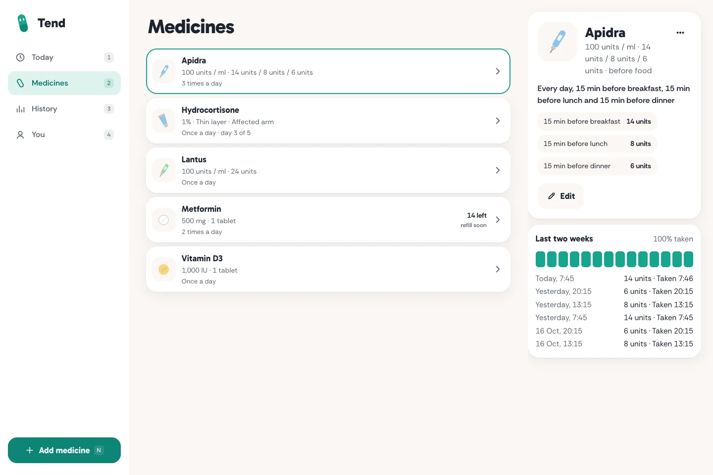

<p align="center">
  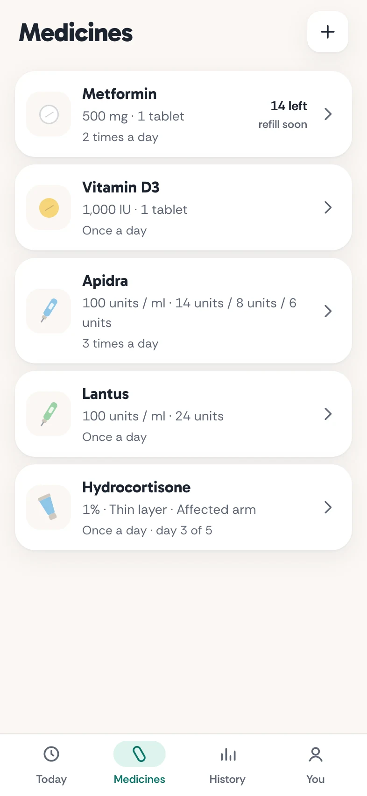
  &nbsp;
  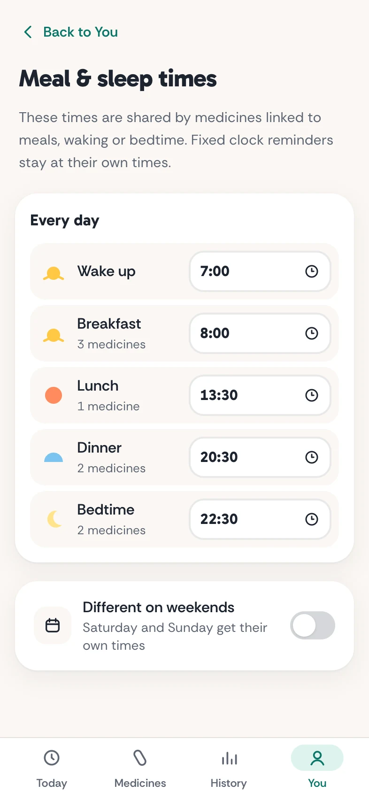
  &nbsp;
  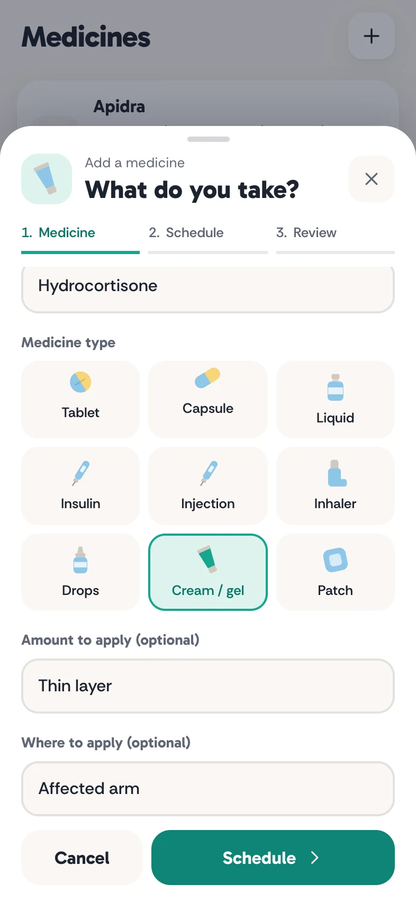
</p>

<p align="center">
  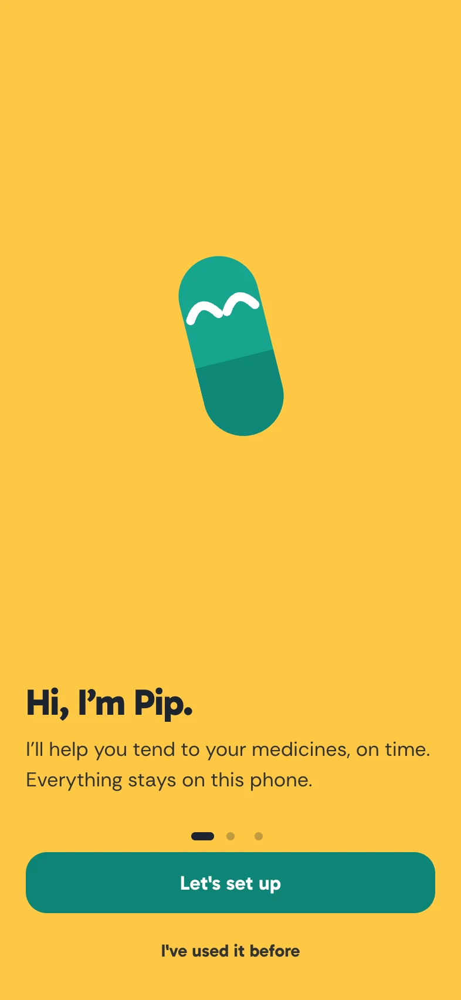
  &nbsp;
  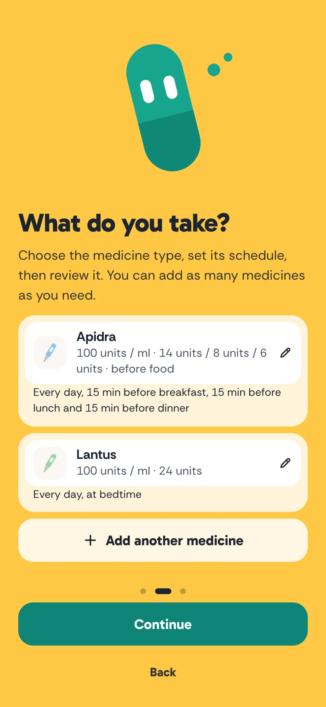
</p>

</details>

## references

the medicine field choices draw on NHS guidance for [insulin](https://www.nhs.uk/medicines/insulin/rapid-acting-insulin/how-and-when-to-take-rapid-acting-insulin/), [topical treatments](https://www.nhs.uk/medicines/mometasone-for-skin/how-and-when-to-use-mometasone-for-skin/), [patches](https://www.nhs.uk/medicines/buprenorphine-for-pain/how-and-when-to-use-buprenorphine/), [inhalers](https://www.nhs.uk/medicines/salbutamol-inhaler/how-and-when-to-use-salbutamol-inhalers/) and [drops](https://www.nhs.uk/medicines/dexamethasone-eye-drops/how-and-when-to-use-dexamethasone-eye-drops/). Tend records a prescribed plan; it does not provide treatment advice.
